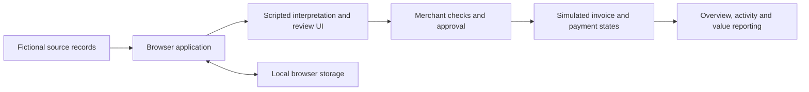
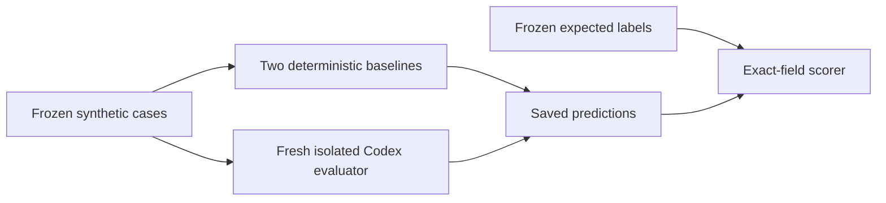

# Revenue Capture architecture notes

## Current implementation

A self-contained HTML file loads custom JavaScript and CSS. Embedded fictional records supply approvals, completion evidence, invoices and simulated outcomes. Application state and preferences are saved in browser storage; UI handlers render Overview, Connections, case review, Value realisation, Activity, Settings and support dialogs. No application backend or live LLM endpoint is connected.

The separate evaluation experiment has a different path:

The fresh evaluator did not receive labels or baseline predictions. The cases and labels still share an AI author; a fresh context does not make the dataset independently designed.

## Proposed production path — not implemented

1. **Permissioned source connectors:** obtain provider authorisation for accounting, delivery, messaging and CRM records; enforce source/customer/time boundaries. Processing filters must not be confused with provider-level permissions.
2. **Evidence preparation:** normalise records, preserve source IDs/timestamps and establish the records available for each job. Treat message content as data, including any embedded instructions.
3. **Model interpretation:** propose links between approval, completion and invoice records; identify scope revisions, prior billing and conflicts. Return evidence references and a propose/hold/exclude decision, not authority to bill.
4. **Deterministic financial checks:** calculate units or hours after included allowances, apply agreed rates/caps, and enforce duplicate, scope and permission checks. Unsupported pricing or unresolved identity/completion stays on hold.
5. **Merchant decision:** present evidence and arithmetic, allow correction or rejection, and require explicit approval before an external invoice/send action.
6. **Invoice and payment adapters:** create the approved draft in the merchant's accounting workflow; track sending, acceptance and payment separately. Match actual payments idempotently and handle partials/reversals before reporting net recovery.
7. **Audit and evaluation:** retain permitted decision history; evaluate corrections and rejected matches before deploying any learning loop. Record exact model versions/settings and evaluate unseen human-labelled records against tuned rules.

## Important boundaries

| Boundary | Prototype | Production requirement |
|---|---|---|
| Source access | Local policy configuration and fictional preview | Provider authorisation and enforceable permissions |
| AI interpretation | Scripted in the UI | Evaluated, cited model proposals with fallbacks |
| Financial arithmetic | Code-based calculation and review gates | Tested calculations, duplicate protection and accounting integration |
| Sending and payment | Simulated states | Approved execution and verified payment events |
| Bank/settlement settings | Illustrative configuration | Authorised provider verification and settlement reconciliation |
| Retention/deletion | Local preferences and browser-state deletion | Enforced storage policy across connected services |
| Rejection learning | Case blocked and logged | Separately validated correction/learning process |

The next gate is permissioned merchant-data validation and independent labels. A controlled pilot would measure verified net recovered cash, false proposals, disputes, duplicates and active review effort. No production or recovery outcome is claimed by this architecture.
